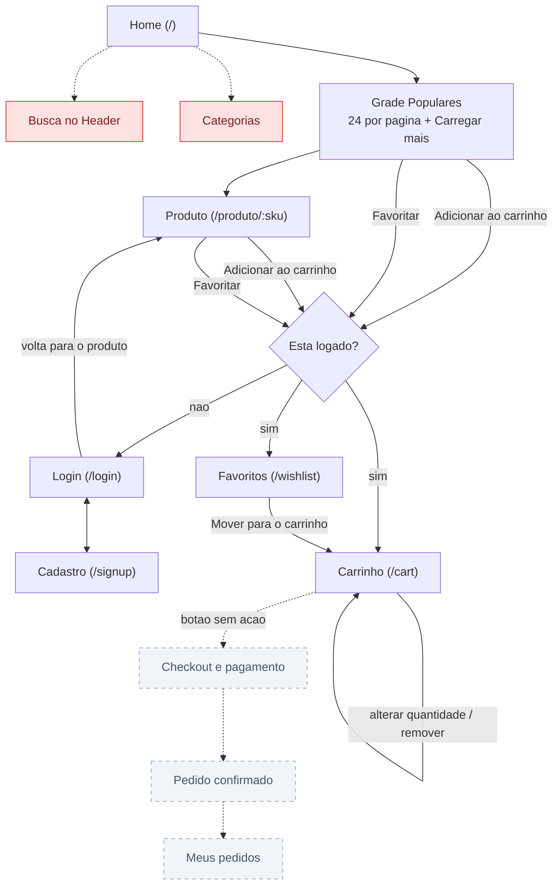
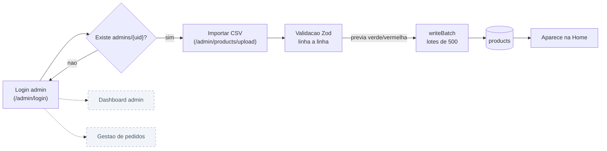
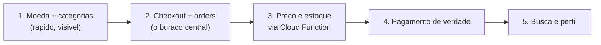

# User flow

Mapa da jornada do cliente na loja. **Descreve o estado real do código**, não o pretendido: linhas tracejadas e caixas vermelhas são caminhos que a pessoa tenta seguir e não conseguem terminar hoje.

---

## Jornada do cliente

**Legenda:** vermelho = existe na interface mas não funciona. Cinza tracejado = não existe ainda.

### O que funciona ponta a ponta

1. Pessoa chega na Home e vê a grade de produtos (24 por vez, com "Carregar mais")
2. Clica num produto e vê detalhe, preço, desconto e avaliação
3. Tenta adicionar ao carrinho ou favoritar → se não estiver logada, vai para `/login` e **volta para o mesmo produto** depois de entrar
4. Cria conta em `/signup` ou entra em `/login`
5. Gerencia o carrinho (quantidade, remoção) e os favoritos, sincronizados em tempo real entre abas e dispositivos
6. Clica em "Continuar para o pagamento" — **e o fluxo acaba aqui**

---

## Jornada do admin

Este fluxo está completo: o admin entra, sobe o CSV, vê a prévia do que é válido e importa. O que falta é o outro lado — não há onde acompanhar vendas.

---

## Onde o fluxo quebra

| # | Problema | Onde | Impacto |
| --- | --- | --- | --- |
| 1 | **Checkout é um beco sem saída.** O botão "Continuar para o pagamento" não tem `onClick` | `src/pages/Cart.tsx:115` | A loja não vende. É o buraco central |
| 2 | **Preço vem do cliente.** O carrinho grava `price` a partir do objeto do navegador | `src/context/CartContext.tsx` | Qualquer pessoa com o console pode gravar `price: 0.01` no próprio carrinho |
| 3 | **Estoque nunca é lido.** O CSV importa `stock` e nada o consulta | `src/types/products.ts` | Dá para comprar 50 unidades de um item que tem 3 |
| 4 | **A busca não busca.** `searchTerm` é atualizado e nunca usado | `src/components/Header.tsx:11` | Campo visível que não faz nada |
| 5 | **Categorias são decorativas.** Imagens fixas com `href="#"`, e `CategoryFilter.tsx` tem **0 bytes** | `src/components/ProductCategory.tsx` | O campo `category` do CSV nunca é usado |
| 6 | **Duas moedas na mesma loja.** O card mostra `$49.90`, o produto e o carrinho mostram `R$49.90` | `src/components/ProductCard.tsx:74` | O mesmo produto com dois preços aparentes |
| 7 | **Frete e taxa são constantes** de R$ 4,00 | `src/pages/Cart.tsx` | Não há endereço nem cálculo |
| 8 | **Sem histórico de pedidos.** Não existe coleção `orders` | — | Depois de comprar, não há comprovante |
| 9 | **Sem recuperação de senha** | — | Esqueceu a senha, perdeu a conta |
| 10 | Quantidade no carrinho usa leitura-modificação-escrita em vez de `increment()` | `src/context/CartContext.tsx` | Duas abas somando ao mesmo tempo podem perder uma contagem |

---

## Próximos passos

### 1. Fechar a compra

Sem isto, nada mais importa: hoje é impossível comprar.

- Tela de checkout com endereço de entrega, revisão do pedido e confirmação
- Coleção `orders` no Firestore, com os itens **congelados** no momento da compra (nome, preço e quantidade não podem mudar depois se o catálogo mudar)
- Esvaziar o carrinho ao concluir
- Página `/orders` com o histórico
- Rotas de `CheckoutLayout` já existem comentadas em `App.tsx`

### 2. Confiança antes de aceitar dinheiro

Itens 2 e 3 da tabela acima. O preço precisa ser **relido de `products`** no momento de fechar o pedido, nunca aceito do cliente — e o estoque, verificado e decrementado. A forma correta é uma Cloud Function criando o pedido numa transação, porque regra de Firestore sozinha não recalcula preço. Isto vem **antes** de integrar qualquer meio de pagamento.

### 3. Deixar as pessoas acharem produtos

- Busca funcionando. O catálogo vem do Firestore, que não faz busca por texto parcial — ou se filtra no cliente (viável até uns poucos milhares de produtos), ou se adota Algolia/Typesense
- Categorias reais: `CategoryFilter.tsx` está vazio e o campo `category` já chega pelo CSV. É a melhoria de maior retorno pelo menor esforço da lista

### 4. Acabamento

- Padronizar a moeda em `R$` (item 6) — correção de um arquivo
- Frete e taxa calculados, em vez de R$ 4,00 fixos
- `sendPasswordResetEmail` na tela de login
- Página de perfil (o cadastro já grava `name` e `email` em `users/{uid}`)
- Login por celular, se ainda fizer sentido — ver a ressalva no README
- Trocar a leitura-modificação-escrita do carrinho por `increment()`

---

## Sugestão de ordem

Começar pelo item 1 dá resultado visível em pouco tempo e prepara a vitrine. O item 2 é o que transforma isto numa loja. O item 3 tem que vir **antes** do 4 — integrar pagamento com preço vindo do cliente é convidar fraude.
